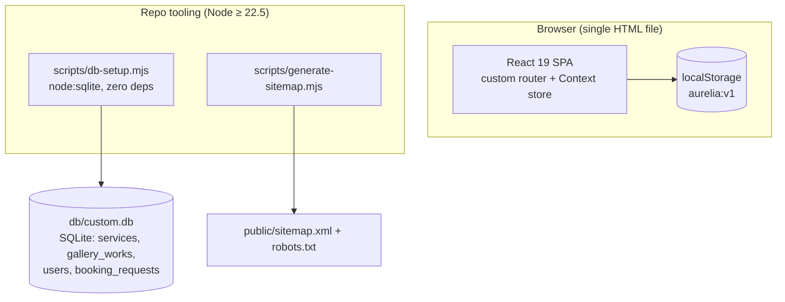

# Aurelia Nail Artistry — Luxury Nail Portfolio

      

A production-grade marketing + booking SPA for a luxury nail studio — a visual and functional superset of `aurelia-nail-artistry-demo.base44.app`, built as a single-file React application with a verified-parity editorial design, a public appointment-request workflow, hashed-credential accounts, an admin booking surface, and a dark-mode theme system the reference doesn't ship.

> **Cloned from the live reference on 2026-10-19.** Route matrix, copy, pricing-free service catalog, studio contact block, and the booking success-state contract are pinned in [`docs/reference-investigation.md`](docs/reference-investigation.md) with evidence labels. All image assets are independently generated — nothing was copied from the reference.

## Key Features

| Feature | Description |
|---|---|
| **Editorial landing page** | Measured-parity home: full-bleed hero, 2×2 portfolio grid, philosophy quote band, experience section, dual CTAs — cream `#f5f3ef` / ink `#1a1a1a` token system |
| **Public booking workflow** | Name/email/phone + service + date + time + notes; native HTML5 baseline for required fields, custom domain rules for future-dates, closed Sun/Mon, slot whitelist; form is *replaced* by the "Request Received" confirmation (reference contract) |
| **Priced services catalog + add-on band** | The six measured services carry their reference prices (`$85`–`$350`, `$200+` verbatim) and an ENHANCEMENTS band lists the four measured add-ons (Hand Massage $20 · Paraffin $25 · Nail Repair $15 · Design Consultation Complimentary); the booking select deliberately stays add-on-free (reference contract, unit-pinned) |
| **Booking persistence + admin surface** | Requests persist to the local store, attach to the signed-in user when one exists, and surface in a role-gated `/admin/bookings` console with cancel/status actions |
| **Accounts (superset)** | Salted WebCrypto SHA-256 digests (`s1$salt$digest`), register → session → sign-out → sign-in, `/account` booking history, protected-route redirect |
| **Dark mode (superset)** | Two-state light ↔ dark toggle — every activation visibly flips the theme; fresh profiles start in OS-following `system` mode until the first interaction; a pre-paint head script applies the stored/OS theme (and tints `theme-color`) before first paint (no flash); `@custom-variant dark` class strategy; semantic tokens flip, hero photography stays light-on-image in both themes; the browser chrome follows the resolved theme via the synced `theme-color` meta |
| **Mobile navigation** | Portal-rendered full-screen menu overlay with focus trap, Escape/scroll-lock, and gap-based spacing (Tailwind v4 `space-y` engine trap pinned by e2e) |
| **Gallery category filters** | Working filter row on `/gallery` (All / Editorial / Bridal / Avant-Garde / Classic / Seasonal) as an accessible `aria-pressed` toggle group over the measured five-cycle category model — active chip white-on-ink, grid filters live |
| **SEO + PWA** | Per-route title/description/OG/canonical/robots contract (soft-404s and private surfaces ship `noindex, follow`; the `/home` alias and case variants canonicalize to the sitemap's lowercase form), JSON-LD (`NailSalon` with `openingHoursSpecification` + `sameAs`, `WebSite`), complete social-card meta (og:image dimensions/alt, twitter alt, og:locale), generated sitemap with git-derived `lastmod` + robots, web manifest + icons incl. apple-touch + maskable |
| **Zero-server persistence** | Browser-only demo store (`localStorage`, `aurelia:v1` namespace) + a zero-dependency `node:sqlite` tooling contract that materializes `db/custom.db` |

## Architecture

**Single-file SPA**: `vite build` emits one self-contained `dist/index.html` (~446 KB, ~118.4 KB gzip) via `vite-plugin-singlefile` — no server runtime, deployable to any static host.

| Layer | Technology | Version | Purpose |
|---|---|---|---|
| UI runtime | React | 19.3 | Function components, hooks only |
| Language | TypeScript | 5.9 (strict) | `noUnusedLocals`, `erasableSyntaxOnly` |
| Build | Vite + vite-plugin-singlefile | 7.3 / 2.3 | One-file production build |
| Styling | Tailwind CSS | 4.3 (CSS-first) | `@theme inline` tokens, no config file |
| Routing | Custom history router (`src/lib/router.tsx`) | — | `pushState`-based, ~107 LOC, case-insensitive matching |
| State | React Context + `localStorage` (`src/lib/store.tsx`) | — | Session, bookings, toasts, theme |
| Unit tests | Vitest | 4.1 | 95 tests, node env |
| E2E tests | Playwright | 1.64 | 214 tests, chromium + iPhone-14 profiles, against `vite preview` |
| Hosted CI | GitHub Actions | — | `verify` + full e2e on every push/PR to `main` (`.github/workflows/ci.yml`) |
| DB tooling | `node:sqlite` (`scripts/db-setup.mjs`) | Node ≥ 22.5 | Materializes `DATABASE_URL` as a real SQLite file |



### File hierarchy (key paths)

```text
📂 luxury-nail-portfolio/
├── 📄 index.html              ← static head fallbacks + font preconnects
├── 📂 src/
│   ├── 📄 index.css           ← design tokens (hex pins), dark variant, trap-log pins
│   ├── 📄 App.tsx             ← route switch (matchPath → page component)
│   ├── 📂 components/         ← chrome.tsx (header/menu/footer/toasts), head-manager.tsx
│   ├── 📂 data/studio.ts      ← single source: services, gallery works, slots, demo users
│   ├── 📂 lib/                ← router, store, booking (pure seam), seo, theme, password, db-path
│   └── 📂 pages/              ← home, gallery, services, about, booking, auth, account, admin, 404
├── 📂 tests/                  ← vitest unit suites + e2e/ Playwright specs
├── 📂 scripts/                ← db-setup.mjs, generate-sitemap.mjs
├── 📂 db/                     ← custom.db (gitignored) + catalog.json marker
├── 📂 docs/                   ← reference investigation, implementation plan, screenshots, skills
└── 📂 skills/                 ← repo-bundled skill library (agents-md, claude-md, readme-md, …)
```

## Quick Start

**Runtimes:** Node.js ≥ 20 (SPA tooling); Node ≥ 22.5 required for `npm run db:*` (ships `node:sqlite`).

```bash
git clone git@github.com:nordeim/luxury-nail-portfolio.git
cd luxury-nail-portfolio
npm install
cp .env.example .env          # pins DATABASE_URL="file:../db/custom.db"
npm run db:setup              # materialize + seed db/custom.db (needs Node ≥ 22.5)
npm run dev                   # vite dev server on http://localhost:5173
```

**Verify setup** — the full gate chain (identical to what hosted CI runs on every push/PR to `main`):

```bash
npm run verify   # typecheck && lint && test (unit) && build
npm run e2e      # 214 Playwright tests against the production preview (builds first)
```

Expected: typecheck silent · eslint silent · `95 passed` · `dist/index.html ~446 kB` · `214 passed`. Every push/PR to `main` runs the same chain in GitHub Actions.

**Demo accounts** (seeded in `src/data/studio.ts`, digests verified by unit tests):

| Role | Email | Password |
|---|---|---|
| Studio admin | `demo@aurelia.studio` | `Aurelia-Demo-2025` |
| Customer | `guest@aurelia.studio` | `Aurelia-Guest-2025` |

## Environment Variables

| Variable | Required | Description |
|---|---|---|
| `DATABASE_URL` | yes | `file:../db/custom.db` — schema-relative (Prisma-style `prisma/` anchor), resolves to `<repoRoot>/db/custom.db`. Relative URLs that would land outside the repo root are rejected by `scripts/db-setup.mjs`; absolute URLs are allowed as explicit overrides (a prominent notice is printed). |
| `VITE_SITE_URL` | optional | Absolute origin for the SEO layer (canonical/OG defaults, sitemap generation). Defaults to `http://localhost:4173`. |

## Testing

```bash
npm run test                # vitest unit suite (node env)
npm run e2e                 # Playwright, both projects, auto-starts vite preview on :4173
npx playwright test tests/e2e/mobile-navigation.spec.ts        # single spec
npx playwright test --project=mobile                           # iPhone-14 profile only
```

- **Unit (95)** — booking validation seam, **theme contract (`resolveTheme` + the two-state `nextThemeMode` with the no-op impossibility invariant)**, password hash round-trip **including demo-seed digest verification**, SEO route map (**/home alias canonical + case-variant lowercase canonical + soft-404/private-surface noindex robots**), db-path resolution contract, db-scripts containment audit **+ the R6 in-place schema upgrade path**, sitemap projection (**git-derived `lastmod` contract**), catalog contract (measured prices verbatim, add-on list, booking-whitelist exclusion), **content-parity contract (R7: measured tagline, the five-cycle category map, experience paragraphs, attribution format, the measured About pack)**.
- **E2E (214)** — smoke, **mobile navigation (the Tailwind v4 `space-y` regression pin + measured 30px links + `aria-current`)**, booking flow (validation → confirmation → admin surface), auth flow, **dark mode (first-click flip + pre-paint script + token values + persistence + theme-color sync)**, visual parity (computed-style assertions on stable selectors **+ measured nav/eyebrow geometry + active-route gold ink + 48px rose-accent quote + About h1 + services pricing/add-on band + gallery filter row + R7 content pins + the R8 featured-in/CTA anatomy pin**), a11y (axe + structure), SEO head (**per-route titles, canonical/og:url, JSON-LD, social-card meta, alias + case-variant canonical, soft-404/private-surface noindex, served robots/sitemap artifacts**), PWA manifest, password hash round-trip. Desktop Chrome + iPhone-14 (chromium engine) profiles; e2e runs against the production build, never the dev server.
- `playwright.config.ts` auto-starts its own `vite preview` — no manual server management.

## Design System

| Token | Light | Dark | Usage |
|---|---|---|---|
| `--background` | `#f5f3ef` (measured) | `#13110f` | Page ground — **hex pins**, hsl drifts 1 unit per engine |
| `--band` | `#1a1a1a` | `#f5f3ef` | Footer/philosophy bands — editorial inversion |
| `--foreground` | `hsl(30 8% 12%)` | `hsl(40 33% 95%)` | Body ink |
| `--gold` | `hsl(36 41% 62%)` | `hsl(38 44% 66%)` | Hover/accents only (fails AA at eyebrow sizes on cream) |
| `--gold-ink` | `hsl(34 15% 38%)` | `hsl(38 44% 66%)` | AA-corrected gold for TEXT states (active nav route) — 5.29:1 on cream / 8.18:1 on dark |
| `--band-accent` | `#d4a5a5` | `#985a5a` | Band rose (eyebrow + quote accent) — 8.02:1 / 4.81:1 on the band ground |
| `--hero-ink` | white (static) | white (static) | Hero copy sits on photography in **both** themes |

Typography: **Cormorant Garamond** display (`font-display`) / **Inter** body (`font-sans`), loaded via Google Fonts with `display=swap` and system fallbacks. Eyebrow geometry is reference-measured (R6): 14px / 0.3em tracking / weight 400; nav links run 0.1em.

## Documentation Map

| Document | Contents |
|---|---|
| [`docs/reference-investigation.md`](docs/reference-investigation.md) | Evidence-labelled observation of the live reference (routes, copy, tokens, auth, booking probe) |
| [`docs/implementation-plan.md`](docs/implementation-plan.md) | Stack decision record, feature sequence, test plan, risks |
| [`docs/remediation-plan-aurelia-r1.md`](docs/remediation-plan-aurelia-r1.md) | Review-round R1: audit findings, live parity sweep evidence, validation ledger (versioned planning docs) |
| [`docs/remediation-plan-aurelia-r2.md`](docs/remediation-plan-aurelia-r2.md) | Review-round R2: theme-switching root-cause analysis + fixes (pre-paint script, two-state cycle), axe 4.14 Label-in-Name isolation |
| [`docs/remediation-plan-aurelia-r3.md`](docs/remediation-plan-aurelia-r3.md) | Review-round R3: sitemap/SEO audit vs the ecommerce-store template + live reference; lastmod, soft-404 noindex, alias canonical, social-card meta, icon surfaces, JSON-LD enrichment |
| [`docs/remediation-plan-aurelia-r4.md`](docs/remediation-plan-aurelia-r4.md) | Review-round R4: R3 validation + canonical case-variant consolidation, private-surface noindex, theme-color sync, doc-drift sweep |
| [`docs/remediation-plan-aurelia-r5.md`](docs/remediation-plan-aurelia-r5.md) | Review-round R5: R4 validation + live regression verification of every fix; auth-page platform-chrome divergence documented in the deviations ledger (R5-01) |
| [`docs/remediation-plan-aurelia-r6.md`](docs/remediation-plan-aurelia-r6.md) | Review-round R6: reference-drift catch-up (services pricing + Add-On band), measured typography-geometry normalization (eyebrow/nav/menu/quote/About), active-route `aria-current` + AA gold-ink, band accent tokens, GitHub Actions CI |
| [`docs/remediation-plan-aurelia-r7.md`](docs/remediation-plan-aurelia-r7.md) | Review-round R7: second reference-drift wave — hero tagline, **gallery category filters + the measured five-cycle (Seasonal)**, About-page rebuild (bio/stats/philosophy band/featured-in), experience-paragraph + attribution + quote-glyph + gallery-intro catch-up |
| [`docs/remediation-plan-aurelia-r8.md`](docs/remediation-plan-aurelia-r8.md) | Review-round R8: R7 surfaces anatomy completion — **featured-in strip as a centered hairline-bordered band (uppercase measured names) + unboxed centered CTA**, gallery caption-treatment deviation ledgered, sitemap-lastmod generation-lag note |
| [`docs/remediation-plan-aurelia-r9.md`](docs/remediation-plan-aurelia-r9.md) | Review-round R9: full validation round — **zero findings of severity**: every R2–R8 regression pin re-verified live (ground matrix, copy pins, pricing/add-ons, filters, R8 band/CTA census, mobile-menu battery + theme-follow), reference re-extracted with **no drift since R8**, operator-credential login re-verified, CI on the R8 head GREEN |
| [`docs/remediation-plan-aurelia-r10.md`](docs/remediation-plan-aurelia-r10.md) | Review-round R10: full validation round — **zero findings of severity** (second consecutive): every R2–R9 regression pin re-verified live, reference re-extracted with **no drift since R9**, operator-credential login re-verified, CI on the R9 head GREEN; F1 capture-tooling record + fix (fullPage capture vs native lazy-loading — `settleLazyImages()` settle pass; all 12 gallery works verified live) |
| [`docs/remediation-plan-aurelia-r11.md`](docs/remediation-plan-aurelia-r11.md) | Review-round R11: full validation round — **zero findings of severity** (third consecutive): every R2–R10 regression pin re-verified live via a scripted 31/31-check battery, reference re-extracted with **no drift since R10**, operator-credential login re-verified, CI on the R10 head GREEN (per the R10 session record; this round's API re-check rate-limited); F1 probe-method record (census multi-select surfaces per select) |
| [`Project_Architecture_Document.md`](Project_Architecture_Document.md) | Full engineering reference: ADRs, topology, layer model, data architecture, security |
| [`AGENTS.md`](AGENTS.md) | Agent rulebook: commands, conventions, framework traps |
| [`CLAUDE.md`](CLAUDE.md) | Session-playbook for AI coding agents |
| [`docs/Tailwind-V4-Validation-Report.md`](docs/Tailwind-V4-Validation-Report.md) | The five v4 engine traps and the validated remediation patterns |
| [`docs/screenshots/`](docs/screenshots/) | Dev-server capture sweep (13 verified PNGs) + review-round comparison sets (14–17 R1, 18–20 R2, 21–23 R3, 24–26 R4, 27–29 R5, 30–33 R6, 34–38 R7, 39–41 R8, 42–44 R9, 45–47 R10, 48–50 R11 — home-light baseline (48) unchanged from R7 at 5286px; 49 dark twin; 50 the gallery filter-row record refresh (12/12 works via the R10 settle pass)); prior-project captures under `legacy-homenest/` |
| [`docs/DEPLOYMENT.md`](docs/DEPLOYMENT.md) | Static-host deployment notes |
| [`docs/how-to-git-push-using-ssh-wrapper_SKILL.md`](docs/how-to-git-push-using-ssh-wrapper_SKILL.md) | Deploy-key push procedure (`ssh_git_wrapper_v3.py`) |

## Troubleshooting

| Issue | Solution |
|---|---|
| `db:setup` writes outside the repo / fails with "OUTSIDE the repo root" | An ambient `DATABASE_URL` is overriding the repo contract. Run `env -u DATABASE_URL npm run db:setup` (the containment audit refuses relative URLs that escape the repo root by design). |
| `db:setup` errors "node:sqlite is unavailable" | The db scripts need Node ≥ 22.5 (`node:sqlite`). The SPA itself runs on Node ≥ 20. |
| Sitemap shows a localhost origin | `VITE_SITE_URL` is unset — the SEO layer defaults to `http://localhost:4173`. Set it, run `npm run seo:generate`, and commit the refreshed `public/` artifacts (see `docs/DEPLOYMENT.md`). |
| Theme: page flashes light before going dark | Served HTML is missing the pre-paint head script (hand-edited head) — restore the synchronous `<head>` script from the repo's `index.html`; the e2e `pre-paint` pin guards it. |
| Theme toggle's first click does nothing visible | Pre-R2-01 bundle (the old `system → light → dark` cycle) — rebuild from the current tree; the two-state cycle makes every click flip the resolved theme. |
| Playwright reports missing browser executables after an install | The lockfile bumped Playwright and needs a newer headless shell — run `npx playwright install chromium` before the first e2e run. |
| Playwright can't find a "Password"/"Account" control | Viewport-dependent affordances: the desktop nav (`Primary`) is hidden on mobile — assert via the mobile menu overlay (`Site menu` dialog). The suite encodes this pattern. |
| Unit test fails on `.env` contract | The gate reads `.env` when present, else `.env.example` — restore the pinned `DATABASE_URL="file:../db/custom.db"` line. |
| `db:setup` fails "no column named price" on an old local db | Fixed in R6 — the script ALTERs pre-R6 databases in place (PRAGMA-guarded); on a pre-R6 checkout, delete `db/custom.db` and re-run `db:setup`. |
| Sitemap is missing `<lastmod>` | Generated in a non-git checkout (tarball build) — the generator omits lastmod loudly when git metadata is unavailable; run from a git clone. |

## Status

Complete and green as of 2026-10-20 (review round R11): reference investigation ✓ · full clone implemented ✓ · **95/95 unit ✓ · 214/214 e2e ✓** · typecheck/lint/build ✓ · theme switching remediated (R2-01) + axe 4.14 Label-in-Name fixed (R2-02) ✓ · sitemap `lastmod` + SEO hardening (R3) ✓ · R4 hardening: canonical case-variant consolidation, private-surface noindex, theme-color follows the resolved theme ✓ · R5 validation: every R4 fix re-verified live; auth-page platform-chrome divergence documented ✓ · R6: reference-drift catch-up (services pricing + Add-On band), measured typography normalization, active-route `aria-current` + AA gold-ink, band accent tokens, GitHub Actions CI (first run green) ✓ · **R7: second reference-drift catch-up — hero tagline, gallery category filters + measured five-cycle (Seasonal), About-page rebuild (bio + stats + philosophy band + featured-in + measured CTA), experience paragraphs, attribution format, quote glyphs, gallery intro** ✓ · **R8: About featured-in/CTA anatomy completion — centered hairline-bordered strip (uppercase measured names), unboxed centered CTA, caption-treatment deviation ledgered** ✓ · **R9: full validation round — zero findings of severity; all R2–R8 pins re-verified live; reference re-extracted with no drift; CI on the R8 head GREEN** ✓ · **R10: full validation round (second consecutive zero-findings round) — all R2–R9 pins re-verified live; reference re-extracted with no drift; CI on the R9 head GREEN; F1 capture-tooling record + settle fix** ✓ · **R11: full validation round (third consecutive zero-findings round) — all R2–R10 pins re-verified live via a scripted 31/31-check battery; reference re-extracted with no drift; CI on the R10 head GREEN (R10 session record)** ✓ · capture sweeps through R11 (50 PNGs) ✓ · all four root docs + distilled skill + DEPLOYMENT guide generated ✓.

No license file is bundled — all rights reserved by the repository owner.
