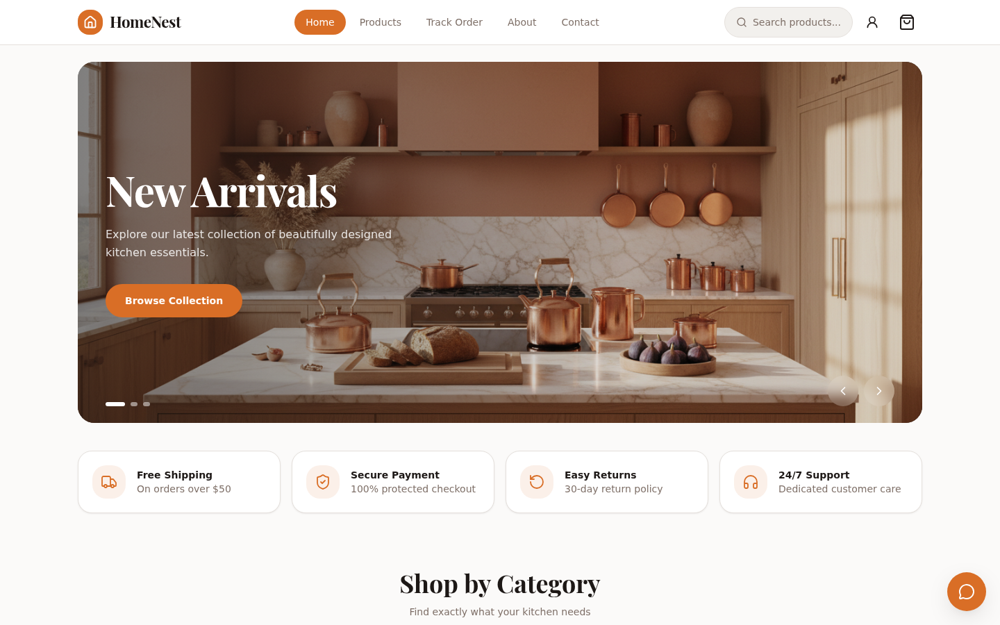
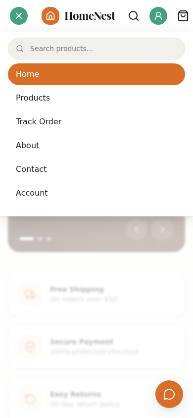

# HomeNest Kitchen

    

A production-grade e-commerce storefront and admin console for premium home & kitchen products — a visual and functional clone of `nest-culinary-hub.base44.app` built as a single-file React SPA, with a 24-product catalog, cart, cash-on-delivery checkout, order tracking, customer accounts, and a full admin console.

| Storefront | Mobile navigation |
|---|---|
|  |  |

## Overview

HomeNest Kitchen solves a specific engineering problem: replicate a reference storefront's look and behavior pixel-faithfully while running entirely in the browser. The reference site is a hosted Base44 app; this clone re-implements its surfaces (home, catalog, product detail, cart, checkout, order success, tracking, account, content pages) with a custom history-API router and a single React context store, then goes beyond it — an admin console, wishlist, promo codes, card payments, and delivery estimates are added as registered supersets that leave the reference's resting visuals untouched.

Everything ships as one self-contained `dist/index.html` (~500 KB): no server, no runtime API calls, no tracking. Commerce state persists in `localStorage`; the repo also pins a schema-relative `DATABASE_URL` contract (`file:../db/custom.db` → repo-root `db/`) so the layout matches the reference architecture for future server work.

SEO is a registered superset: per-route titles/canonicals/OG-Twitter tags, a generated `robots.txt` + `sitemap.xml` (all 24 products), and schema.org JSON-LD (Organization/WebSite + per-product Product nodes) — the reference ships none of the dynamic layer and lists private routes in its sitemap.

## Key Features

| Feature | Description |
|---|---|
| 🏠 Reference-parity storefront | Home hero carousel (fixed 500/600px card, black tint), category icon tiles with per-category gradient discs, scroll-snap product carousels, feature bar, gradient CTA banner, dark footer, floating chat FAB |
| 🛍️ Catalog & discovery | 24 products across 8 categories, live search, category filter, four sort orders, discount/featured badges, quick-add |
| 📄 Product detail | Reference `/product/:id` URLs (slug deep links supported), quantity stepper with stock clamps, Add-to-Cart / Buy Now, related products |
| 🛒 Cart & drawer | Slide-out drawer + full page, delta steppers, free shipping over $50 (flat $9.99 under), collapsed promo-code entry (NEST10) |
| 💳 Checkout | Single-page reference layout with Cash on Delivery by default and a demo card option, inline validation, order notes |
| ✅ Order success & tracking | Token-gated confirmation view, COD amount notice, delivery window estimate, 5-step order-progress tracker by order number |
| 👤 Accounts | Email/password auth with redirect validation (open-redirect hardened), profile, password change, address book, wishlist |
| 🛠️ Admin console | Revenue/orders/products stats, order status transitions with carrier tracking, product stock/visibility editing, carousel management |
| ♿ Accessible | 44px touch targets, focus-visible rings, semantic landmarks, one `<main>` per page, reduced-motion support, modal mobile menu + cart drawer with focus traps, axe structural-a11y gate on eight surfaces |
| 🔍 SEO-ready | Per-route titles/canonical/OG-Twitter via a pure head seam, generated robots.txt + sitemap.xml (24 product URLs), schema.org JSON-LD (Organization, WebSite, per-PDP Product nodes) |
| 🧪 Tested | 104 Vitest unit tests on pure seams (incl. the db-scripts contract) + 152 Playwright E2E specs (304 runs) including computed-style visual-parity (home content layer, PDP/catalog/content-page layer, watch-list closure layer, checkout/cart/account/track layer, order-success/account-orders layer, mobile header parity, hover-state pins), modal semantics, a11y smoke gates, and the served SEO artifacts |

## Architecture

**Stack** — every version matches the lockfile:

| Layer | Technology | Version | Purpose |
|---|---|---|---|
| Build tool | Vite | 7.3.7 | Dev server, bundling, SPA fallback preview |
| UI runtime | React | 19.2.6 | Components, context store |
| Language | TypeScript | 5.9.3 | Strict mode (`noUnusedLocals`, `noUnusedParameters`) |
| Styling | Tailwind CSS | 4.1.17 | CSS-first `@theme` tokens, no config file |
| Icons | lucide-react | 1.55.0 | SVG icon set |
| Class utility | clsx + tailwind-merge | 2.1.1 / 3.4.0 | Conditional class composition |
| Unit tests | Vitest | 4.1.11 | Node-env tests on pure seams |
| E2E tests | @playwright/test | 1.64.0 | Production-build browser tests |
| Output | vite-plugin-singlefile | 2.3.3 | Inlines JS/CSS into one HTML file |

**Layer model** (dependencies point downward only):

```
pages/        route surfaces (home, shop, checkout-flow, account, content, admin)
components/   shared chrome (header, footer, drawers, forms) + product cards
lib/          router, store (single context), commerce math, db-path contract
data/         catalog seed (brand, categories, products, carousel, demo users)
types.ts      domain types (Product, Order, Address, User, …)
```

Full details — ADRs, data model, security posture, testing strategy — live in [`Project_Architecture_Document.md`](Project_Architecture_Document.md). Agent-facing rules and the Tailwind v4 trap log live in [`AGENTS.md`](AGENTS.md).

## File Hierarchy

```
📂 homenest-store-g
├── 📄 index.html                  # Entry; loads Playfair Display, mounts #root
├── 📄 vite.config.ts              # React + Tailwind + singlefile plugins, @ alias
├── 📄 vitest.config.ts            # Node env, src/** + tests/** *.test.ts
├── 📄 playwright.config.ts        # Preview server :4173, chromium + mobile projects
├── 📄 .env                        # DATABASE_URL="file:../db/custom.db"
├── 📂 src
│   ├── 📄 App.tsx                 # Route switch (27 routes)
│   ├── 📄 types.ts                # Domain types
│   ├── 📂 components              # chrome.tsx (header/footer/drawer), product.tsx (cards)
│   ├── 📂 data                    # catalog.ts (seed catalog + demo users)
│   ├── 📂 lib                     # store.tsx, router.tsx, commerce.ts, db-path.ts, storage-key.ts
│   ├── 📂 pages                   # home, shop, checkout-flow, account, content, admin
│   └── 📄 index.css               # @theme design tokens + base styles
├── 📂 tests
│   ├── 📄 db-path.test.ts         # DB URL contract tests
│   ├── 📄 catalog-hash.test.ts    # catalog ↔ STORAGE_KEY registry contract
│   ├── 📄 catalog-registry.json   # catalog revision → storage key pin
│   └── 📂 e2e                     # smoke, mobile-navigation, mobile-header-parity,
│                                  # cart-drawer, catalog, cart-checkout, auth-admin,
│                                  # a11y-smoke, visual-parity specs
├── 📂 db                          # catalog.json brand config (custom.db is git-ignored)
├── 📂 docs/screenshots            # Dev-server screen captures
└── 📂 public/images               # Product/hero imagery
```

## Quick Start

Requires Node.js ≥ 20.

```bash
git clone https://github.com/nordeim/homenest-store-g.git
cd homenest-store-g
npm install
npm run dev
```

Open `http://localhost:5173`. Verify setup: the home page renders the "New Arrivals" hero carousel and the footer shows four link columns.

**Demo accounts** (also shown on the login page):

| Role | Email | Password |
|---|---|---|
| Customer | `john@example.com` | `Demo1234!` |
| Admin | `admin@homenest.kitchen` | `Admin1234!` |

## Environment Variables

| Variable | Required | Value | Notes |
|---|---|---|---|
| `DATABASE_URL` | Yes | `file:../db/custom.db` | Schema-relative URL; resolves to the repo-root `db/` folder (contract-tested in `tests/db-path.test.ts`). The SPA keeps runtime state in localStorage — this pins the reference architecture's storage layout. `npm run db:setup` materializes it as a real SQLite file (session 26, R26-03). |
| `E2E_PORT` | No | `4173` | Port for the Playwright preview server. |
| `E2E_BASE_URL` | No | `http://127.0.0.1:4173` | Override to run E2E against an already-running server. |
| `VITE_SITE_URL` | No | `http://localhost:4173` | Absolute origin for the SEO layer (canonical/og:url fallbacks, sitemap generation). Override + `npm run seo:generate` when deploying elsewhere. |

## Testing

```bash
npm run typecheck       # tsc --noEmit (strict; no unused locals/params)
npm run test            # Vitest unit tests (104)
npm run build           # production single-file build (prebuild regenerates SEO artifacts)
npm run e2e             # Playwright E2E (152 specs / 304 runs) — requires npm run build first
npm run verify          # typecheck + lint + unit + build in one command
npm run db:setup        # materialize the SQLite contract db (repo-root db/custom.db)
```

- E2E boots `vite preview` on port 4173 automatically; each test runs in a fresh browser context (fresh localStorage).
- `tests/e2e/visual-parity.spec.ts` asserts computed-style parity with the reference site — treat failures as build-breakers, not flakes.
- The mobile project emulates iPhone 14 on the chromium engine (WebKit needs host libraries most CI images lack).

## Design System

Tokens live in `src/index.css` under Tailwind v4's `@theme`; measured values below come from the reference site.

| Token | Value | Usage |
|---|---|---|
| `--color-background` | `hsl(30 25% 98%)` · `rgb(251,250,249)` | Page canvas |
| `--color-primary` | `hsl(24 70% 50%)` · `rgb(217,110,38)` | CTAs, active nav pill, badges |
| `--color-accent` | `hsl(160 40% 45%)` · `rgb(69,161,130)` | In-stock labels, menu close disc |
| `--color-destructive` | `hsl(0 72% 51%)` · `rgb(220,40,40)` | Discount pills, errors |
| `--color-badge` | `#fbbf24` · `rgb(251,191,36)` | Star ratings (amber-400; session-38 — the "Featured" pill is now `bg-primary`, see `--color-primary`) |
| `--color-footer` | `rgb(29,24,22)` | Footer canvas (session-30: = foreground; was `rgb(32,27,24)`) |
| `--color-footer-rule` | `hsl(30 25% 98% / 0.1)` · `rgba(251,250,249,0.1)` | Footer divider (session-34; alpha baked — v4 `/10` would color-mix in oklab) |
| `--color-panel` | `hsl(0 0% 100% / 0.8)` · `rgba(255,255,255,0.8)` | Sticky-header glass (session-36; the menu panel body is solid `bg-card`) |
| `--color-border-soft` | `hsl(30 15% 88% / 0.5)` · `rgba(229,224,220,0.5)` | Header/panel 0.5-alpha hairlines (session-36) |
| `--color-hero-body` | `hsl(0 0% 100% / 0.8)` · `rgba(255,255,255,0.8)` | Hero paragraph (session-36; the reference's `text-white/80`) |
| `--color-dot-idle` | `hsl(0 0% 100% / 0.4)` | Idle carousel dots (session-36) |
| `--color-frost` | `hsl(0 0% 100% / 0.1)` | Hero carousel arrow glass (session-36) |
| `--color-quick-add` | `hsl(0 0% 100% / 0.9)` | Card quick-add pill, hover-revealed (session-38) |
| `--color-secondary` | `hsl(33 31% 93%)` · `rgb(243,238,232)` | CTA cream button bg (session-38 re-measurement) |
| `--color-secondary-hover` | `hsl(33 31% 93% / 0.8)` | CTA button hover (session-38) |
| `--color-primary-film` | `hsl(24 70% 50% / 0.1)` | FeatureBar icon disc film (session-38) |

Typography: **Playfair Display** 700 for display headings (`font-display`), **Inter** for body text (Google Fonts with system-stack fallback, session-34 parity with the reference's typeface), 12px base radius with fully-rounded pill CTAs. Cards use white surfaces on a 1px `--color-border`. The v4 `hover:*` variant is overridden to `&:hover` (v3 behavior — the reference applies hover unconditionally; see AGENTS.md trap #9).

## Known Issues & Troubleshooting

| Issue | Solution |
|---|---|
| `npm audit` flags braces/micromatch via vite-plugin-singlefile | Build-time-only dependency of the bundler's glob handling; inputs are trusted repo files. Accepted risk — do not downgrade the plugin for this. |
| E2E fails to bind port 4173 | Stop the stale preview: `pkill -f "vite preview"`, or set `E2E_PORT`. |
| Admin/account pages bounce to login after a hard refresh | Fixed by gating on the store's `ready` flag; if you see it again, you reintroduced the hydration race. |
| Old cart/products appear after a catalog change | Edit the seed → bump `STORAGE_KEY` in `src/lib/storage-key.ts` and add the new hash row to `tests/catalog-registry.json` (the `catalog-hash` test enforces this with repair instructions). |
| WebKit/`--project=mobile` complains about missing host libs | The mobile project pins `browserName: "chromium"` on the iPhone 14 profile; install WebKit libs only if you specifically need Safari coverage. |

## Documentation

- [`AGENTS.md`](AGENTS.md) — agent rules, Tailwind v4 trap log, testing quirks
- [`CLAUDE.md`](CLAUDE.md) — six-phase workflow and per-tech standards
- [`Project_Architecture_Document.md`](Project_Architecture_Document.md) — ADRs, layer model, data & security architecture, testing strategy
- [`docs/DEPLOYMENT.md`](docs/DEPLOYMENT.md) — deployment guide for the single-file SPA: build, static-host serving, env contract, SEO origin sync, troubleshooting
- [`homenest-store-g_SKILL.md`](homenest-store-g_SKILL.md) — distilled engineering skill: 20-section reference (stack, design system, trap log, patterns, debugging) for any agent working on this repo
- [`docs/remediation-plan.md`](docs/remediation-plan.md) — audit findings (F-01…F-17), executed remediation ToDo with TDD evidence (R-01…R-24, R3-01…R3-06, R4-01…R4-04, R5-01…R5-06), residual risks, session-3/4/5 addenda
- [`docs/session_1.md`](docs/session_1.md) — Session 1 execution transcript (audit → parity → tests → docs → push)
- [`docs/session_2.md`](docs/session_2.md) — Session 2 execution transcript (validation → remediation plan → SKILL distillation → push)
- [`docs/session_3.md`](docs/session_3.md) — Session 3 execution transcript (ledger validation → TDD follow-ups → mobile parity → push)
- [`docs/session_4.md`](docs/session_4.md) — Session 4 execution transcript (doc-drift audit → cart-drawer modal → authenticated axe gate → menu re-sweep → push)
- [`docs/session_5.md`](docs/session_5.md) — Session 4 continuation transcript (context-reset session that executed the R4 work)
- [`docs/session_6.md`](docs/session_6.md) — Session 5 execution transcript (password hardening → combobox keyboard → re-sweep → account layout fix → push)
- [`docs/session_8.md`](docs/session_8.md) — Session 8 execution transcript (sitemap & SEO workstream → reference re-sweep → docs → push)
- [`docs/session_10.md`](docs/session_10.md) — Session 10 execution record (DEPLOYMENT.md alignment → full re-validation → no-drift re-sweep → push)
- [`docs/session_12.md`](docs/session_12.md) — Session 12 execution record (fresh-clone rebuild → full re-validation → third no-drift sweep → push)
- [`docs/session_14.md`](docs/session_14.md) — Session 14 execution record (fourth no-drift sweep → R14-01 combobox live-region announcements via TDD → push)
- [`docs/session_16.md`](docs/session_16.md) — Session 16 execution record (fifth no-drift sweep → R16-01 ESLint flat config wired into `verify` → push)
- [`docs/session_18.md`](docs/session_18.md) — Session 18 execution record (sixth no-drift sweep → R18-01 PWA manifest superset via TDD → push)
- [`docs/session_20.md`](docs/session_20.md) — Session 20 execution record (seventh no-drift sweep → full re-validation → candidate-list retirement)
- [`docs/session_22.md`](docs/session_22.md) — Session 22 execution record (eighth no-drift sweep → retired-list validation track → push)
- [`docs/session_24.md`](docs/session_24.md) — Session 24 execution record (ninth no-drift sweep → validation track held → push)
- [`docs/session_26.md`](docs/session_26.md) — Session 26 execution record (tenth sweep → reference drift found: menu trigger green disc + plain account icon → TDD remediation + db scripts → push)
- [`docs/session_28.md`](docs/session_28.md) — Session 28 execution record (eleventh sweep → trigger drift AGAIN (green → bare → green → bare oscillation) → TDD revert to bare icon → CLAUDE.md count refresh → push)
- [`docs/session_30.md`](docs/session_30.md) — Session 30 execution record (twelfth sweep → footer token drift rgb(32,27,24) → rgb(29,24,22) (= bg-foreground) → TDD fix + docs → push; trigger held, no fifth flip)
- [`docs/session_32.md`](docs/session_32.md) — Session 32 execution record (workspace reset recovery + thirteenth no-drift sweep → validation track holds → push)
- [`docs/session_34.md`](docs/session_34.md) — Session 34 execution record (fourteenth sweep → footer text-layer + brand-mark + body-font (Inter) remediation via TDD → pixel-identical footer rects → push)
- [`docs/session_36.md`](docs/session_36.md) — Session 36 execution record (fifteenth sweep → v4 hover-variant un-gating + header glass + solid menu panel + hero/PDP action-row remediation via TDD → push)
- [`docs/session_38.md`](docs/session_38.md) — Session 38 execution record (sixteenth sweep → home-page content layer: category icon tiles, scroll-snap carousels, card chrome/badges/quick-add, FeatureBar, CTA, hero container, page rhythm, header action-row hovers → push)
- [`docs/session_39.md`](docs/session_39.md) — Session 39 execution record (seventeenth sweep → PDP/catalog/content-page layer: wrapper rhythms, md grid breakpoint, gallery tile, info rows, cream pills, stepper, related carousel, /products filters + 2-up mobile grid, contact/about wrappers, PDP shipping rows removed → push; the file's prior session-38 transcript content is preserved in git at `c1d162b`)
- [`docs/session_40.md`](docs/session_40.md) — Session 40 execution record (eighteenth sweep → watch-list closure layer: PDP gallery hairline (thumbnail row disproven), about internals (h3 cards, md grid, flat h1, cream CTA), the legal template + reference-verbatim policies + dynamic date, contact form fields → push; the file's prior session-39 transcript content is preserved in git at `d2019e3`)
- [`docs/session_41.md`](docs/session_41.md) — Session 41 execution record (nineteenth sweep → the checkout/cart/account/track layer: max-w-5xl shell + lg:grid-cols-3 checkout layout, shadcn v3 fields, PM radio-cards, sticky OS, cart square-image cards + muted-pill steppers + amber COD box, account profile card + one-card order list, track pill search → push; the file's prior raw transcript is preserved in git at `7ec9a15`)
- [`docs/session_42.md`](docs/session_42.md) — Session 42 execution record (twentieth sweep → the order-success/account-orders layer: no-disc header + primary-line pill, the large amber COD variant, the gallery-band card with square images, the 4-row delivery block with phone, 36px pill links, per-order account cards → push; the file's prior raw transcript is preserved in git at `7ec9a15`)
- [`docs/session_43.md`](docs/session_43.md) — Session 43 execution record (twenty-first sweep → the cart-drawer superset layer: reference-has-no-drawer fact established, drawer restyled to the s41-measured cart design language — "Your Cart" 20px/700, 16px hairline cards with square 80×80 images, muted-pill steppers, inline trash-2, "Order Summary" footer with the h-10 pill CTA — and registered as PAD §5.6 #22 → push; the file's prior raw transcript is preserved in git at `a0d5ae0`)
- [`docs/session_44.md`](docs/session_44.md) — Session 44 execution record (twenty-second sweep → the first full-surface drift re-check since the cart-drawer layer: every pinned surface re-measured live on both sides — zero drift, zero new findings, validation track; fresh reference order placed as success-page evidence; mobile-menu portal + focus trap verified by hand → push; the file's prior raw transcript is preserved in git at `5f585da`)
- [`docs/session_45.md`](docs/session_45.md) — Session 45 execution record (twenty-third sweep → the second consecutive full-surface drift re-check: every pinned surface re-measured live on both sides — zero drift, zero new findings, validation track; fresh reference order ORD-MVA3M5YT as success-page evidence; mobile-menu portal + 13-Tab focus trap + Escape focus-restore verified by hand; 530.57 KB deterministic build (environmental +77 B read) + 312/312 E2E after a chromium-1248 cache restore → push; the file's prior raw transcript is preserved in git at `f092666`)
- [`docs/session_46.md`](docs/session_46.md) — Session 46 execution record (twenty-fourth sweep → the third consecutive full-surface drift re-check: every pinned surface re-measured live on both sides — zero drift, zero new findings, validation track; fresh reference order ORD-MVA85CBJ as success-page evidence; mobile-menu portal + 13-Tab focus trap + Escape focus-restore verified by hand; 530.57 KB deterministic build (md5 identical to s45 — the +77 B environmental read did not compound) + 312/312 E2E on the first attempt → push; the file's prior raw transcript is preserved in git at `a62fc85`)
- [`docs/session_47.md`](docs/session_47.md) — Session 47 execution record (twenty-fifth sweep → the fourth consecutive full-surface drift re-check: every pinned surface re-measured live on both sides — zero drift, zero new findings, validation track; fresh reference order ORD-MVC1DNQK as success-page evidence; mobile-menu portal + 13-Tab focus trap + Escape focus-restore verified by hand (real-click path; synthetic-click artifact documented in §36.4-D5); 530.57 KB deterministic build (md5 identical to s45/s46, third consecutive round) + 312/312 E2E on the first attempt (chromium-1248 pre-installed — the cache regressed between rounds) → push; the file's prior raw transcript is preserved in git at `2c21b6f`)
- [`docs/session_48.md`](docs/session_48.md) — raw session transcript for the session-43 record (owner-added `0b25748`)
- [`docs/session_49.md`](docs/session_49.md) — raw session transcript for the session-44 record (round-added, follow-up commit)
- [`docs/session_50.md`](docs/session_50.md) — raw session transcript for the session-44 record (owner-added `2352d73`/`6c9626e`)
- [`docs/session_51.md`](docs/session_51.md) — raw session transcript for the session-45 record (round-added, follow-up commit)
- [`docs/session_52.md`](docs/session_52.md) — raw session transcript for the session-45 record (owner-added `2242e69`, Chinese-language)
- [`docs/session_53.md`](docs/session_53.md) — raw session transcript for the session-46 record (round-added, follow-up commit)
- [`docs/session_54.md`](docs/session_54.md) — raw session transcript for the session-46 record (owner-added `6b5c7c4`)
- [`docs/session_55.md`](docs/session_55.md) — raw session transcript for the session-47 record (round-added, follow-up commit)
- [`docs/session_37.md`](docs/session_37.md) — raw session transcript for the session-36 record
- [`docs/session_27.md`](docs/session_27.md) / [`docs/session_29.md`](docs/session_29.md) / [`docs/session_31.md`](docs/session_31.md) / [`docs/session_33.md`](docs/session_33.md) / [`docs/session_35.md`](docs/session_35.md) — raw session transcripts for the session-26, session-28, session-30, session-32 and session-34 records
- [`docs/session_25.md`](docs/session_25.md) — raw session transcript for the session-24 record
- [`docs/session_7.md`](docs/session_7.md) / [`docs/session_9.md`](docs/session_9.md) / [`docs/session_11.md`](docs/session_11.md) / [`docs/session_13.md`](docs/session_13.md) / [`docs/session_15.md`](docs/session_15.md) / [`docs/session_17.md`](docs/session_17.md) / [`docs/session_19.md`](docs/session_19.md) / [`docs/session_21.md`](docs/session_21.md) / [`docs/session_23.md`](docs/session_23.md) — raw session transcripts for the session-5, session-8, session-10, session-12, session-14, session-16, session-18, session-20, and session-22 records
- [`worklog.md`](worklog.md) — running multi-agent work log
- [`docs/screenshots/`](docs/screenshots) — dev-server screen captures (desktop + mobile)
